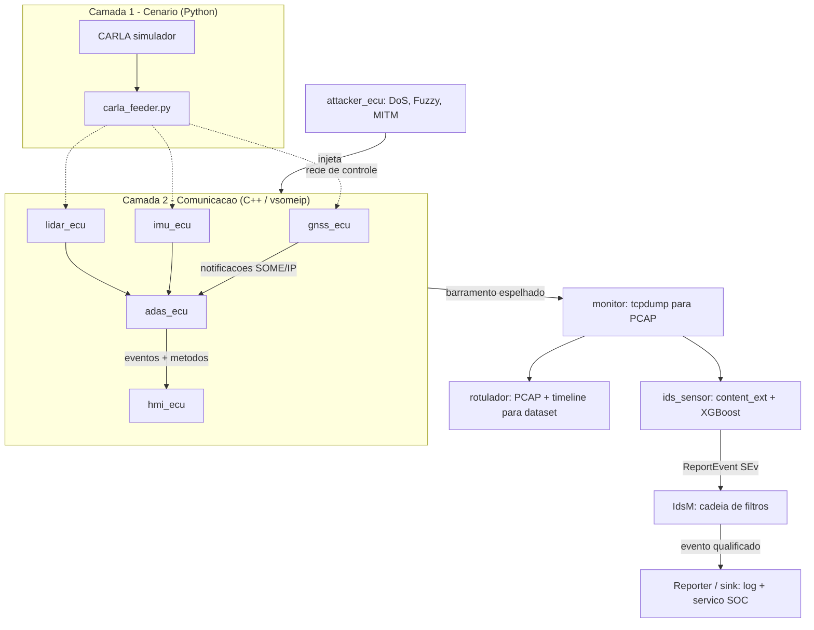
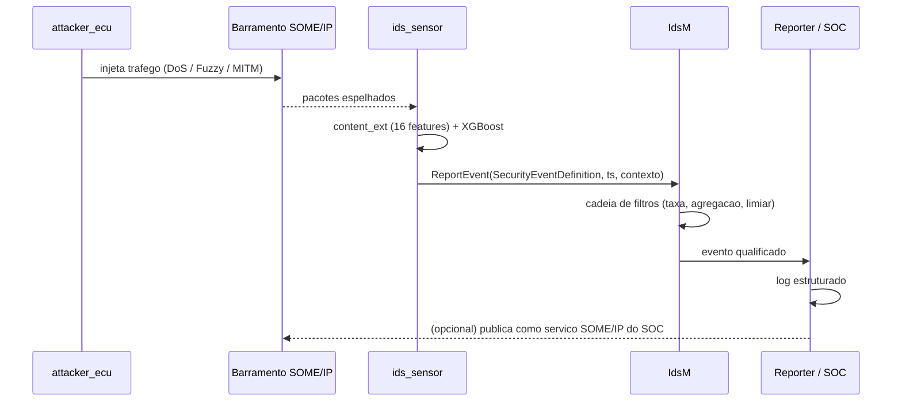
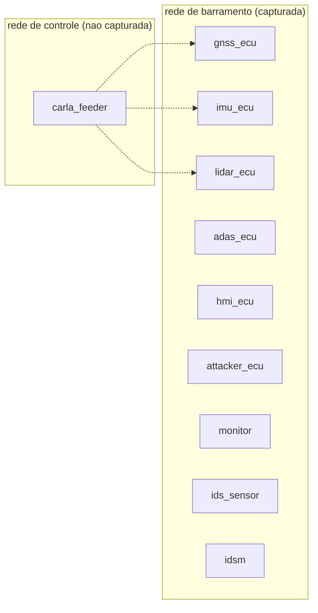

# Arquitetura — someip-testbench

## 1. Princípio reitor: a matriz de comunicação é a fonte única

Como no CANoe, **tudo nasce de um único arquivo de descrição** da rede: quais serviços existem,
quais eventos e métodos cada um oferece, quem provê e quem consome, em que IP e porta, e como o
Service Discovery está configurado.

Desse arquivo (`platform/comm_matrix.yaml`) um gerador produz, de forma determinística:

| Artefato gerado | Para quê |
|---|---|
| `vsomeip-<node>.json` | Configuração da pilha vsomeip de cada nó |
| `services.hpp` | IDs de serviço/instância/evento/método e structs de payload em C++ |
| `*_skeleton.hpp` / `*_proxy.hpp` | Esqueleto do provedor e do consumidor (estilo `ara::com`) |
| `labels.yaml` | Mapa IP para papel, usado pelo rotulador do PCAP |
| `wireshark_someip.cfg` | Nomes de serviço/método para o dissector decodificar a trace |

Isso garante que **o código, a configuração da pilha, a rotulagem e a decodificação nunca
divergem**, que é o ponto fraco típico de bancadas montadas à mão.

## 2. Visão geral em camadas

```
┌─ CAMADA 1 · CENÁRIO (Python) ───────────────────────────────┐
│ CARLA: mundo, veículo, tráfego, sensores                     │
│ carla_feeder.py: dinâmica + GNSS/IMU/LiDAR a cada tick       │
└───────────────┬──────────────────────────────────────────────┘
                │ rede de CONTROLE (não capturada)
                ▼
┌─ CAMADA 2 · COMUNICAÇÃO (C++, estilo AUTOSAR AP) ───────────┐
│ Nós ECU simulados, 1 container e 1 IP cada:                  │
│   gnss_ecu · imu_ecu · lidar_ecu · adas_ecu · hmi_ecu        │
│   Skeleton (provê) / Proxy (consome) sobre vsomeip           │
│   SOME/IP-SD real (multicast)                                │
└───────────────┬──────────────────────────────────────────────┘
                │ rede de BARRAMENTO: é esta que capturamos
   ┌────────────┼───────────────┬──────────────────┐
   ▼            ▼               ▼                  ▼
┌─ C.3 ──┐  ┌─ C.4 ──────┐  ┌─ C.5 ───────────────────────────┐
│INJEÇÃO │  │ CAPTURA    │  │ SECURITY EVENT / IdsM            │
│attacker│  │ monitor:   │  │ ids_sensor → EventReporter       │
│_ecu    │  │ tcpdump    │  │      ↓                           │
│DoS     │  │ → PCAP     │  │   IdsM (cadeia de filtros)       │
│Fuzzy   │  │ + ground   │  │      ↓                           │
│MITM    │  │   truth    │  │   Reporter/sink (log + SOC)      │
└────────┘  └────────────┘  └──────────────────────────────────┘
```



## 3. Camada 1 — Cenário (Python)

O CARLA roda em **modo síncrono**: cada tick avança a simulação de forma determinística e carimba
um **clock único**, usado depois para alinhar ataque, detecção e captura.

O `carla_feeder.py` lê, por tick, a dinâmica do ego e as leituras de GNSS, IMU e LiDAR, e as
entrega aos nós C++.

**Por que Python aqui:** a API do CARLA é madura e documentada em Python; a de C++ é penosa de
compilar e não acrescenta nada, porque esta camada **não aparece no barramento capturado**.

**Transporte CARLA para os nós C++:** datagramas em uma **rede de controle separada**, nunca na
rede do barramento. Isso é essencial: se o tráfego do feeder vazasse para a rede capturada,
poluiria o dataset com pacotes que não são SOME/IP.

## 4. Camada 2 — Comunicação (C++)

Cada ECU é um processo C++ pequeno: `main()` mais a lógica, apoiado numa biblioteca interna
`libecu` que oferece o padrão da AUTOSAR Adaptive sobre o vsomeip.

| Conceito AUTOSAR AP | `libecu` | vsomeip por baixo |
|---|---|---|
| `ara::com` Skeleton | `ecu::Skeleton` | `offer_service`, `notify` |
| `ara::com` Proxy | `ecu::Proxy` | `request_service`, `subscribe`, `send` |
| Event (notificação) | `ecu::Event<T>` | eventgroup e notificação |
| Method (request/response) | `ecu::Method<Req,Res>` | mensagem REQUEST/RESPONSE |
| Field (get/set/notify) | `ecu::Field<T>` | método e evento |
| `InstanceSpecifier` | `ecu::InstanceSpecifier` | service id e instance id |

Nós previstos:

| Nó | Papel | Provê | Consome |
|---|---|---|---|
| `gnss_ecu` | sensor | posição, velocidade | — |
| `imu_ecu` | sensor | aceleração, giro | — |
| `lidar_ecu` | sensor | nuvem reduzida, obstáculo | — |
| `adas_ecu` | função derivada | estado AEB, alvo | GNSS, IMU, LiDAR |
| `hmi_ecu` | consumidor | — | ADAS, GNSS |
| `attacker_ecu` | adversário | tráfego forjado | observa o SD |

A **serialização** segue as regras do SOME/IP (big-endian, alinhamento AUTOSAR). A validação é
objetiva: o dissector SOME/IP do Wireshark precisa decodificar os campos corretamente.

## 5. Camada 3 — Injeção de ataques

Duas superfícies, como no CANoe, que injeta tanto pelo nó simulado quanto no barramento:

| Superfície | Como | Ataques |
|---|---|---|
| **Via serviço** (vsomeip) | O `attacker_ecu` descobre o serviço pelo SD e forja notificações legítimas em forma, adulteradas em conteúdo | MITM (single e multi), spoof |
| **On-the-wire** (socket raw) | Monta quadros Ethernet diretamente | DoS (inundação), Fuzzy (serviço, método e conteúdo aleatórios) |

O cenário é um YAML, herdado do `someip-traffic-simulator`: o que atacar, quando disparar, a que
taxa e por quanto tempo. Cada ataque **carimba a janela de tempo e o tipo**, que, com o IP de
origem do atacante, produz o *ground truth* por pacote.

## 6. Camada 4 — Captura e rotulagem

O `monitor` é passivo: `tcpdump` na interface do barramento, gerando PCAP bruto. O `rotulador`
cruza o PCAP com a *timeline* do cenário e o mapa IP para papel, e emite o dataset **no mesmo
formato da primeira contribuição**, o que o torna diretamente comparável.

## 7. Camada 5 — Security Event e IdsM

É a camada que o CANoe não tem e o diferencial da bancada.

O `ids_sensor` consome o tráfego, extrai as 16 features de conteúdo, classifica com o XGBoost e
**traduz a classe predita em um Security Event tipado**:

| Classe predita | `SecurityEventDefinition` | Dados de contexto |
|---|---|---|
| `dos` | `SEV_DOS` | IP de origem, serviço alvo, taxa observada |
| `fuzzy` | `SEV_MALFORMED_MESSAGE` | IP, service e method id inválidos |
| `mitm_single` | `SEV_SPOOFED_NOTIFICATION` | IP, serviço forjado, confiança |
| `mitm_multi` | `SEV_MULTI_SOURCE_SPOOF` | IPs envolvidos, confiança |
| `normal` | *(não reporta)* | — |

A API segue a spec do Adaptive: constrói-se um **`EventReporter`** a partir de um
`InstanceSpecifier` e chama-se **`ReportEvent(...)`**, opcionalmente com *timestamp*, contador e
dados de contexto. O **IdsM** aplica a **cadeia de filtros** associada ao `SecurityEventDefinition`
(limitação de taxa, agregação, limiares) e emite o evento **qualificado** ao reporter.



**Convergência importante:** para ser um nó da bancada, a inferência precisa rodar em C++. Isso é
**o mesmo trabalho** identificado na análise de latência: o gargalo de cerca de 0,5 ms por chamada
é o custo de atravessar a fronteira **Python para a biblioteca nativa**, não a travessia das
árvores (que leva cerca de 1 µs). Chamando o motor nativo direto do C++, essa fronteira deixa de
existir. Uma única implementação resolve as duas frentes.

## 8. Implantação



Docker Compose, **um container e um IP por ECU**, com **duas redes separadas**:

- `bus`: rede do barramento, com multicast habilitado, porque o SD depende disso. É a única capturada.
- `ctrl`: rede de controle, por onde o feeder do CARLA alimenta os sensores.

Um IP por nó é o que torna a **rotulagem por IP de origem** confiável, a mesma estratégia já usada
no dataset da primeira contribuição.

## 9. Estrutura de diretórios proposta

```
someip-testbench/
├── platform/
│   ├── comm_matrix.yaml        # a "database": servicos, eventos, metodos, deployment
│   └── scenarios/              # cenarios de ataque (YAML)
├── tools/
│   ├── gen_config.py           # matriz -> vsomeip json + headers C++ + labels
│   └── label_pcap.py           # PCAP + timeline -> dataset rotulado
├── src/
│   ├── libecu/                 # fachada estilo ara::com sobre vsomeip
│   ├── libidsm/                # EventReporter + IdsM + cadeia de filtros
│   ├── nodes/                  # gnss_ecu, imu_ecu, lidar_ecu, adas_ecu, hmi_ecu
│   ├── attacker/               # attacker_ecu (via servico e on-the-wire)
│   └── ids_sensor/             # extrator + modelo XGBoost nativo
├── scenario/
│   └── carla_feeder.py         # camada CARLA (Python)
├── deploy/
│   ├── docker-compose.yml
│   └── Dockerfile.*
└── docs/
```

## 10. Decisões técnicas

| Decisão | Escolha | Por quê | Alternativa descartada |
|---|---|---|---|
| Pilha SOME/IP | **vsomeip (COVESA)** | É a implementação de referência e **a mesma usada para gerar o dataset do baseline**, o que dá continuidade metodológica | Implementação própria em Python, sem SD real |
| API de serviço | **Fachada `libecu` estilo `ara::com`** sobre vsomeip | Permite usar o vocabulário da spec (Skeleton, Proxy, Event, Field) com dependência mínima e build reprodutível | **CommonAPI C++**: exige toolchain Franca/Java e sua API não é `ara::com` de qualquer forma |
| Descrição da rede | **YAML próprio** inspirado no ARXML | Legível, versionável e suficiente para gerar config, código e rótulos | ARXML completo: verboso e exigiria ferramental pesado |
| Camada CARLA | **Python** | API madura e não aparece no barramento capturado | Cliente C++ do CARLA: custo alto, ganho nulo |
| Inferência do IDS | **TL2cgen** no build do modelo selecionado | É o **mais rápido** com o modelo adotado (1,39 µs, contra 2,85 do avaliador compacto e 51 do `libxgboost`), gera C99 sem dependência de runtime, e é ferramenta de terceiros, estabelecida e citável. Com 250 árvores o código gerado cabe em cache, e aí os limiares viram constantes imediatas | **`libxgboost`**: 190 MB e 37x mais lenta por chamada, fica como **oráculo** de paridade. **Avaliador compacto**: 2x mais lento, mas com paridade exata e WCET limitado, serve como segundo oráculo |
| Isolamento de rede | **Duas redes Docker** | Impede que o tráfego do feeder contamine o dataset | Rede única: poluiria a captura |

### O que atravessa a fronteira Python → C++

O desenvolvimento e o treino ficam em Python; o `ids_sensor` é C++. Mas **o TL2cgen cobre apenas o
modelo de árvores**. São quatro artefatos cruzando a fronteira, e três ainda não existem em C++:

| Artefato | Como atravessa | Estado |
|---|---|---|
| Modelo de árvores | TL2cgen gera C99 no build | resolvido |
| **Extrator das 16 features** | **código C++ novo** | **a escrever, maior esforço** |
| *Byte-models* (log-probabilidade por camada) | dado embarcado | a exportar |
| Normalização (`xmin`/`xmax` do treino) | dado embarcado | a exportar |

O **extrator** é o caminho crítico, e não é óbvio: ele tem **estado** (janelas deslizantes por fluxo
e por origem, além do último pacote por chave de fluxo), calcula log-verossimilhança e entropia
cruzada sobre os *byte-models*, e distância de Hamming entre *payloads* consecutivos. Nada disso é
função pura, então portar é mais difícil que portar o modelo.

É também onde entra a otimização já identificada da *source diversity*: trocar o conjunto
recomputado a cada pacote por um contador incremental de distintos, O(1) em vez de O(janela). Faz
sentido nascer assim na versão C++, em vez de otimizar o Python e portar depois.

**A paridade vale para o extrator, não só para o modelo.** É mais fácil errar ali: basta uma janela
começar cheia em vez de vazia, ou uma ordem de atualização diferente, e as features divergem em
silêncio. O critério de aceite é *mesmo PCAP produz as mesmas 16 features nos dois lados*, não
apenas a mesma classe no fim.

### Nota sobre a inferência: bancada não é ECU

Vale separar os dois contextos, porque eles têm requisitos opostos.

A bancada roda em **container x86**. Ali não valem as restrições de ECU de produção (perfil POSIX
**PSE51**, diretrizes **AUTOSAR C++14**, proibição de alocação dinâmica, análise de **WCET**,
tamanho em flash). Logo, linkar a `libxgboost` é não só aceitável como **preferível**: é o mesmo
motor do treino, o que elimina qualquer risco de divergência numérica, e já entrega o ganho de
latência, porque o gargalo era a fronteira Python.

O caminho de ECU é outro problema, e só precisa ser resolvido se e quando formos para hardware
embarcado. Lá a `libxgboost` não serve: são dezenas de MB, com OpenMP, alocação dinâmica e sem
WCET analisável. A solução seria exportar o modelo como **tabelas `const` mais um avaliador de
laço limitado** (um ensemble de árvores é simples o bastante para isso, ao contrário de uma rede
neural), usando a `libxgboost` como **oráculo** de validação.

**Decisão:** começar pela `libxgboost`. A comparação com alternativas de exportação fica para
depois, com o número da bancada já em mãos.

## 11. Referências de projeto

- Spec do IdsM da AUTOSAR Adaptive (classe `EventReporter`, `SecurityEventDefinition`,
  `SecurityEventContextMapping`) e a do Classic (`IdsM_ReportEvent`).
- `Jonas0828/autosar-idsm` (GitHub): implementação aberta de IdsM, útil como referência antes de
  escrevermos a `libidsm`.
- Dissector SOME/IP do Wireshark: critério objetivo de validação da serialização.
