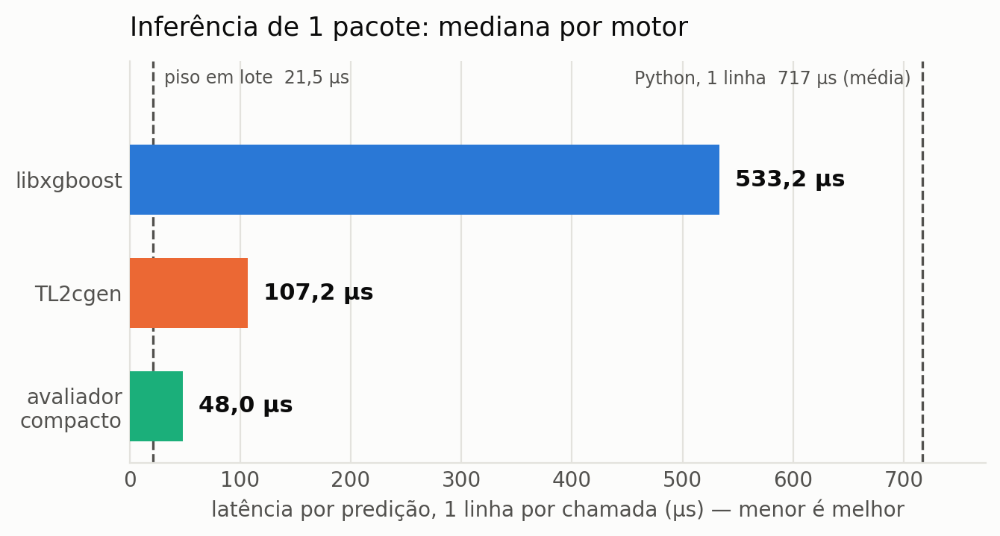
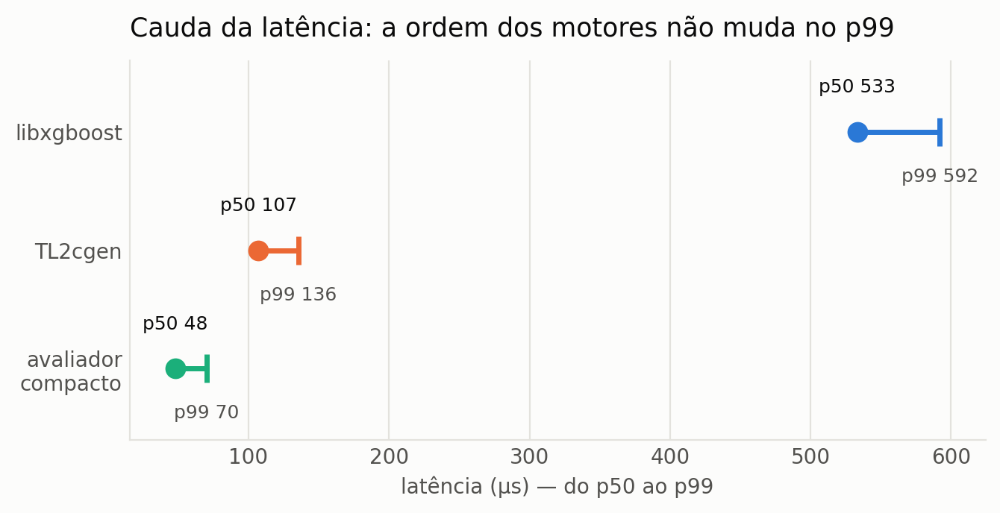
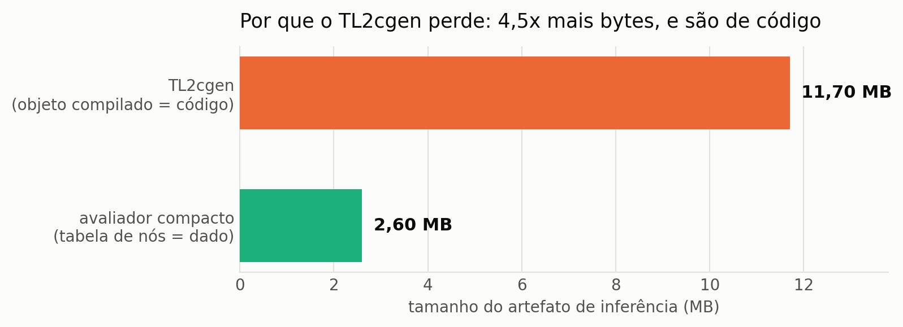

# Resultados: libxgboost x TL2cgen x avaliador compacto

**Máquina:** AWS EC2 `c7a.2xlarge`, AMD **EPYC 9R14** (Zen 4), 8 vCPU sem SMT, Ubuntu 24.04,
gcc 13.3, xgboost 3.3.0, treelite 4.7.2, tl2cgen 1.0.0. Medição fixada em **1 núcleo**
(`taskset -c 0`, `nthread=1`), 512 linhas distintas, 5000 repetições.

**Modelo:** `multi:softprob`, 5 classes, 300 rodadas → **1500 árvores**, **162.334 nós**.

## Métricas coletadas

Por motor, sobre **5000 chamadas** cronometradas individualmente:

| Métrica | Por quê |
|---|---|
| **p50, p95, p99**, mínimo e máximo da latência | Num IDS a cauda importa mais que a média; a média sozinha esconde o p99 |
| Média da latência | Comparabilidade com o número já publicado da primeira contribuição |
| **Desvio absoluto máximo** nas probabilidades, contra o `inplace_predict` do Python | Detecta divergência numérica silenciosa |
| **Classes divergentes** (contagem de `argmax` diferente) | O que de fato importa para a detecção |
| Tamanho do artefato de inferência | Explica a causa do resultado |
| Tempo de build | Custo prático no pipeline |

Medições com o processo fixado em 1 núcleo (`taskset -c 0`) e `nthread=1`.

## Latência

<picture>
  <source media="(prefers-color-scheme: dark)" srcset="figs/fig1-latencia-dark.png">
  
</picture>

| Caminho | média | p50 | p95 | p99 | vs. piso | vs. `libxgboost` |
|---|---:|---:|---:|---:|---:|---:|
| Python, 1 linha (`inplace_predict`) | 716,6 | — | — | — | 33x | 0,8x |
| `libxgboost` C API, 1 linha | 535,2 | 533,2 | 573,5 | 591,9 | 24,8x | 1x |
| TL2cgen (C99 gerado), 1 linha | 108,2 | 107,2 | 125,9 | 135,7 | 5,0x | **5,0x** |
| **Avaliador compacto**, 1 linha | **48,5** | **48,0** | **62,7** | **70,3** | **2,2x** | **11,1x** |
| `libxgboost` em lote (512 linhas) | 21,5 | — | — | — | 1x (piso) | — |

Valores em µs. O número do Python vem do `prepare.py`, que só coleta média.

## Cauda

<picture>
  <source media="(prefers-color-scheme: dark)" srcset="figs/fig2-cauda-dark.png">
  
</picture>

A ordem dos motores **não muda no p99**, então a conclusão não depende da média. As caudas também
são proporcionalmente parecidas (p99 cerca de 11% acima do p50 na `libxgboost`, 27% no TL2cgen, 46%
no avaliador compacto): quanto menor a latência base, mais visível o ruído do sistema operacional.

Variação entre execuções da ordem de ±6% (a `libxgboost` deu 534,8 e 502,4 em rodadas anteriores,
com menos repetições).

**Paridade numérica contra o `inplace_predict` do Python:**

| Motor | Desvio máximo | Classes divergentes |
|---|---|---|
| `libxgboost` C API | 0,000e+00 (exato) | 0 / 512 |
| TL2cgen | 1,609e-06 | 0 / 512 |
| **Avaliador compacto** | **0,000e+00 (exato)** | 0 / 512 |

## Conclusão 1: a hipótese do Python estava errada

Chamando a C API direto do C, o custo caiu de 716,6 para ~502 µs: **o Python respondia por cerca de
25%**. Os **~500 µs restantes são intrínsecos ao caminho de predição de uma linha da `libxgboost`**.

Isso **reverteu a decisão** de usar a `libxgboost` no `ids_sensor` em regime por pacote: ela é a
**pior** das três opções nesse regime.

## Conclusão 2: o problema do TL2cgen é tamanho de código

<picture>
  <source media="(prefers-color-scheme: dark)" srcset="figs/fig3-footprint-dark.png">
  
</picture>

O TL2cgen ganha da `libxgboost` por 5,0x, mas perde do avaliador compacto por 2,2x. A causa é
tamanho de **código**:

| Representação | Tamanho | Natureza |
|---|---:|---|
| C gerado pelo TL2cgen | 323.231 linhas → **objeto de 11,7 MB** | código |
| Tabelas do avaliador compacto | **2,60 MB** (162.334 nós × 16 B) | dado |

O código das 1500 árvores não cabe em cache de instruções, então cada predição percorre megabytes
de instruções. **Geração de código não escala para ensembles grandes.** Trocar código por dado
resolve: a tabela é 4,5x menor e é percorrida como dado, não executada.

## Conclusão 3: o avaliador compacto domina em todos os eixos

São cerca de 30 linhas de C:

```c
typedef struct { float thr; int32_t feat; int32_t left; int32_t right; } node_t;  /* 16 B */

for (int t = 0; t < n_trees; ++t) {
    int32_t i = roots[t];
    for (int d = 0; d < DEPTH_GUARD; ++d) {          /* laco limitado */
        if (nodes[i].feat < 0) break;                /* folha */
        i = (x[nodes[i].feat] < nodes[i].thr) ? nodes[i].left : nodes[i].right;
    }
    margin[t % n_class] += nodes[i].thr;
}
softmax(margin, n_class);
```

| Critério | `libxgboost` | TL2cgen | Avaliador compacto |
|---|---|---|---|
| Latência mediana (1 linha) | 533 µs | 107 µs | **48 µs** |
| Paridade | exata | 1,6e-06 | **exata** |
| Dependências | 190 MB de `.so` | nenhuma | **nenhuma** |
| Tempo de build | — | **3 min 44 s** | **instantâneo** |
| Alocação dinâmica no caminho quente | sim | não | **não** |
| WCET analisável | não | difícil | **sim** (`n_trees × DEPTH_GUARD`) |

Ou seja, a opção mais rápida é também a mais simples, a mais portável e a única com WCET
analisável. Não há trade-off a fazer aqui.

## Armadilha encontrada (e que a paridade pegou)

O `base_score` deste modelo **não é escalar, é um vetor por classe**:
`[2,7467, -1,0028, -0,3698, -0,7514, -0,6228]`.

A suposição inicial era de que, sendo escalar, ele cancelaria no softmax (que é invariante a
deslocamento) e poderia ser ignorado. **Sendo vetor, ele não cancela** e precisa entrar como margem
inicial de cada classe. Se isso passasse batido, o detector erraria silenciosamente.

É o argumento a favor de tratar a conferência de paridade como **critério de aceite**, não como
verificação opcional.

## O que ainda sobra

O avaliador compacto está em 48,1 µs contra um piso de 21,5 µs em lote. Os 2,2x restantes devem vir
de falhas de cache de **dados** (a tabela tem 2,6 MB, acima do L2) e do laço por árvore. Caminhos
para fechar essa diferença, se for necessário:

- reordenar os nós por profundidade para melhorar localidade;
- encolher o nó (índice de feature em `int16`, filhos relativos) para caber mais em cache;
- **micro-batching**, que continua sendo a alavanca de maior efeito e menor esforço.

## Como reproduzir

Ver [README.md](README.md). Resumo:

```bash
pip install treelite tl2cgen
python prepare.py       --model .../results/model_16.json --out build
python export_tables.py --model .../results/model_16.json --out build
bash build.sh build
taskset -c 0 ./build/bench build .../results/model_16.json 5000
python plot_results.py
```

---

# REVISÃO: o mesmo confronto com o modelo correto

As medições acima usaram o modelo de **300 rodadas e profundidade 8** (1500 árvores, 162.334 nós).
A varredura de encolhimento mostrou depois que esse modelo estava 23x maior que o necessário
(ver [../model-sweep/RESULTADOS.md](../model-sweep/RESULTADOS.md)). Refazendo o confronto com o
modelo adotado, **50 rodadas e profundidade 4** (250 árvores, 7.136 nós), o resultado **se inverte**.

| Motor | modelo antigo (300×8) | **modelo adotado (50×4)** | |
|---|---:|---:|---|
| Python `inplace_predict` | 716,6 | 135,5 | |
| `libxgboost` C API | 533,2 | 51,05 | |
| **TL2cgen** | 107,2 | **1,39** | **vence** |
| avaliador compacto | 48,0 | 2,85 | |

Valores em µs, mediana, 1 núcleo, 5000 chamadas. Paridade: `libxgboost` e avaliador compacto
exatos (0,0); TL2cgen 3,87e-07, com 0/512 classes divergentes.

## A conclusão anterior estava errada

Este documento afirmava que os ~535 µs eram **"intrínsecos ao caminho de predição de uma linha da
`libxgboost`"**, independentes do tamanho do modelo. **Não são.** A mesma biblioteca caiu de 533
para 51 µs apenas por trocar o modelo.

O raciocínio que levou ao erro foi: "300 árvores de profundidade 8 dão ~2400 comparações, logo ~1 µs
de trabalho real, logo os 535 µs não podem ser travessia". A premissa estava errada por duas razões:
com 5 classes são **1500** árvores, não 300; e a medição em lote já indicava ~21,5 µs de computação
real por predição, não 1 µs.

**A explicação correta é mais simples: o fator dominante era o tamanho do modelo e o cache**, em
todos os motores. Modelo grande torna tudo lento; modelo pequeno torna tudo rápido, e então a
geração de código assume a liderança, porque os limiares viram constantes imediatas, sem carga de
memória nem perseguição de ponteiro.

## Todas as objeções ao TL2cgen caíram junto

| | modelo antigo | modelo adotado |
|---|---:|---:|
| latência | 107,2 µs | **1,39 µs** |
| tempo de compilação | 3 min 44 s | **3,7 s** |
| objeto compilado | 11,7 MB | **535 KB** |
| linhas de C geradas | 323.231 | 14.085 |

O custo de build, que era o argumento contra usar TL2cgen dentro do laço do toolchain, deixou de
existir.

## O que resta do avaliador compacto

Ele **deixou de ser uma melhoria de desempenho**: agora é 2x mais lento. Mantém três propriedades
que o TL2cgen não tem, e que o tornam útil por outro motivo:

- **paridade exata** (0,0 contra 3,87e-07), o que o qualifica como segundo oráculo independente;
- **modelo como dado**, trocável sem recompilar;
- **WCET limitado por construção** (`n_trees × DEPTH_GUARD`).

O papel dele passa de "melhoria reservada" para **ativo de validação**. Não é papel menor: foi a
conferência cruzada de paridade que revelou que o `base_score` deste modelo é um vetor por classe,
e não um escalar, erro que passaria silencioso.

**Decisão: TL2cgen no `ids_sensor`.**
