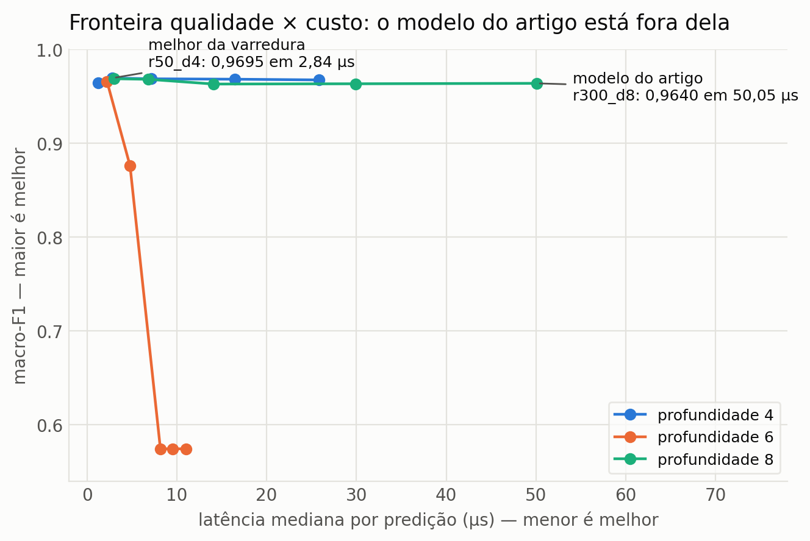
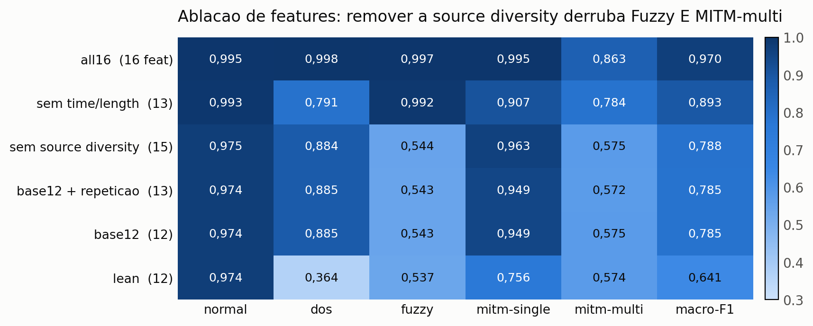
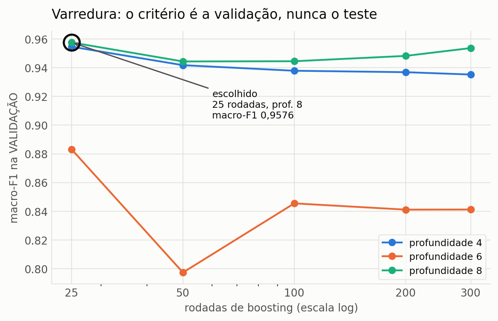
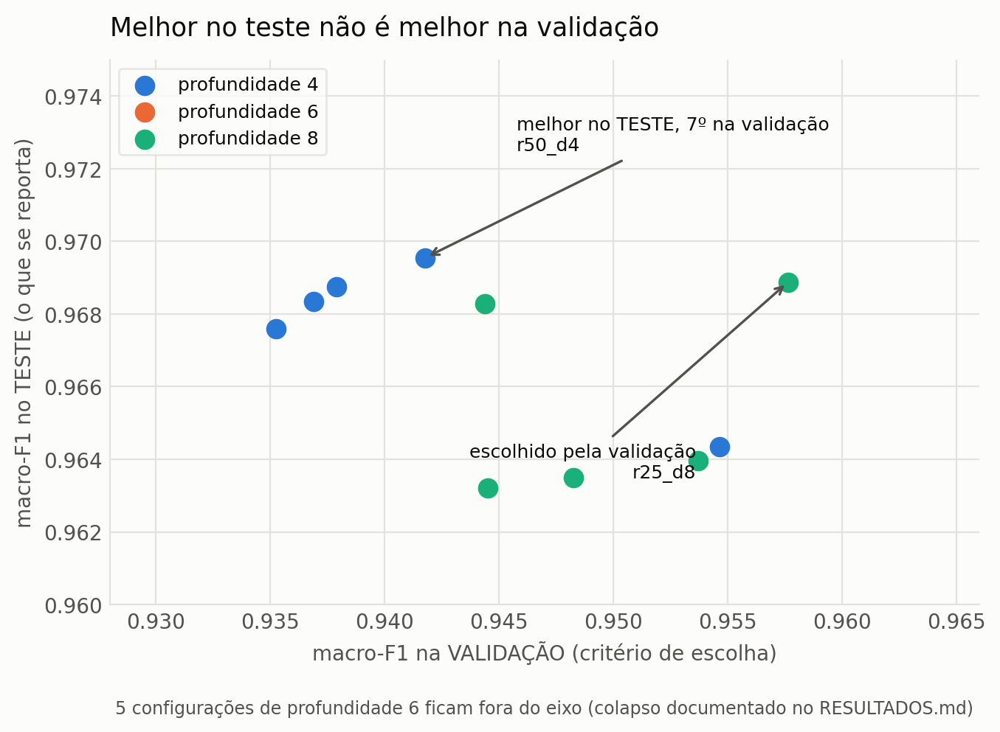

# Resultados: encolhimento do modelo

**Máquina:** AWS EC2 `c7a.2xlarge`, AMD EPYC 9R14 (Zen 4), 1 núcleo (`taskset -c 0`), xgboost 3.3.0.
**Dataset:** completo, 14.233.354 pacotes; split temporal (treino 9.963.346 / teste 4.270.008).
**Latência:** avaliador compacto, 3000 chamadas por configuração, 1 linha por chamada.

Metodologia inspirada em Dal Zotto & Moraes (SBCCI 2025), que encolhem o modelo XGBoost
iterativamente aceitando perda limitada da métrica, para tornar a inferência barata o bastante
para embarcar.

## O achado

O modelo do artigo (300 rodadas, profundidade 8) **não está na fronteira qualidade × custo**.
Existe configuração **melhor em métrica e 17x mais barata**.

<picture>
  <source media="(prefers-color-scheme: dark)" srcset="figs/fig-fronteira-dark.png">
  
</picture>

| | modelo do artigo | melhor da varredura | |
|---|---:|---:|---|
| configuração | 300 rodadas, prof. 8 | **50 rodadas, prof. 4** | |
| macro-F1 | 0,9640 | **0,9695** | melhor |
| nós | 162.334 | **7.136** | **23x menos** |
| tabela | 2,60 MB | **0,11 MB** | 23x menor |
| latência (p50) | 47,1 µs | **2,83 µs** | **16,7x mais rápido** |
| treino | 268,7 s | **64,7 s** | 4x mais rápido |

## Por classe: a classe difícil foi a que mais ganhou

A preocupação era que o macro-F1 se mantivesse enquanto a classe difícil (MITM-multi) degradasse.
**Aconteceu o oposto.**

| configuração | macro | normal | dos | fuzzy | mitm_single | **mitm_multi** |
|---|---:|---:|---:|---:|---:|---:|
| r300_d8 (artigo) | 0,9640 | 0,9935 | 0,9965 | 0,9988 | 0,9930 | **0,8380** |
| **r50_d4** | **0,9695** | 0,9946 | 0,9982 | 0,9968 | 0,9952 | **0,8630** |
| r25_d8 | 0,9689 | 0,9945 | 0,9981 | 0,9991 | 0,9947 | 0,8580 |
| r25_d4 | 0,9643 | 0,9945 | 0,9970 | 0,9899 | 0,9812 | 0,8591 |

A MITM-multi sobe de **0,8380 para 0,8630**. O modelo grande estava **sobreajustando**, e a classe
mais difícil era a que mais sofria com isso. Encolher não foi um sacrifício: foi correção.

Note também que **mais rodadas pioram** em todas as profundidades estáveis (prof. 4: 0,9695 em 50
rodadas contra 0,9676 em 300). É o comportamento esperado de sobreajuste sob split temporal, em que
o conjunto de teste é um período posterior.

## O que isso faz com o trabalho de otimização anterior

| Caminho | µs/pred |
|---|---:|
| Python, modelo do artigo | 716,6 |
| `libxgboost` C API, modelo do artigo | 533,2 |
| TL2cgen, modelo do artigo | 107,2 |
| avaliador compacto, modelo do artigo | 48,0 |
| **avaliador compacto + r50_d4** | **2,83** |

O "piso" de 21,5 µs que tínhamos medido em lote **não era um piso**: era propriedade de um modelo
grande demais. Com o modelo certo, uma predição unitária custa menos que um oitavo daquilo.

**A maior alavanca não era o motor de inferência, era o tamanho do modelo.** Toda a comparação entre
`libxgboost`, TL2cgen e avaliador compacto foi feita otimizando dentro de um modelo fixo, que por
sua vez estava 23x maior que o necessário.

## Anomalia não explicada: profundidade 6

| rodadas | 25 | 50 | 100 | 200 | 300 |
|---|---:|---:|---:|---:|---:|
| macro-F1 | 0,9658 | 0,8761 | **0,5744** | **0,5744** | **0,5744** |

O colapso é **determinístico e idêntico** em três configurações distintas, até a quarta casa. Não é
ruído: o modelo converge para o mesmo estado degenerado e rodadas extras não mudam nada. Por classe,
em `r100_d6`, o `dos` cai para 0,2782 e o `mitm_single` para 0,3761, enquanto `normal` fica em
0,9112, ou seja, a falha é concentrada em classes específicas, não uniforme.

Profundidades 4 e 8 são estáveis, o que torna o caso ainda mais estranho. **Não tenho explicação**,
e não investiguei a fundo porque nenhuma configuração candidata está nessa faixa. Fica registrado
como anomalia a investigar, não como conclusão.

## Consequência para o artigo

O artigo reporta 0,9640 com 300 rodadas e profundidade 8. Existe um modelo **melhor e muito mais
barato**. Trocar implica refazer matrizes de confusão, curvas ROC/PR, custo por categoria e as
tabelas de latência. É decisão em aberto, não aplicada.

## Como reproduzir

```bash
python sweep.py --repo <repo-do-ids> --out sweep     # extrai 1x, treina as 15 configuracoes
gcc -O2 -std=c99 -o sweep_eval sweep_eval.c -lm
taskset -c 0 ./sweep_eval sweep/<cfg>/tables.bin <rows.bin> 16 3000
python plot_sweep.py
```

---

# Ablação de features (modelo r50_d4)

Três perguntas numa execução: a tese 12→16 sobrevive ao modelo encolhido? Dá para remover feature
agora que a extração domina? E `r50_d4` contra `r25_d8` é sinal ou ruído?

<picture>
  <source media="(prefers-color-scheme: dark)" srcset="figs/fig-ablacao-dark.png">
  
</picture>

| subconjunto | nf | macro | extração | normal | dos | fuzzy | mitm-single | mitm-multi |
|---|---:|---:|---:|---:|---:|---:|---:|---:|
| **all16** | 16 | **0,9695** | 21,91 µs | 0,9946 | 0,9982 | 0,9968 | 0,9952 | 0,8630 |
| sem time/length | 13 | 0,8933 | 21,31 µs | 0,9928 | **0,7905** | 0,9917 | 0,9072 | 0,7841 |
| sem source diversity | 15 | 0,7880 | 12,77 µs | 0,9746 | 0,8843 | **0,5440** | 0,9627 | **0,5746** |
| base12 + repetição | 13 | 0,7848 | 12,66 µs | 0,9742 | 0,8850 | **0,5433** | 0,9493 | 0,5724 |
| base12 | 12 | 0,7853 | 12,11 µs | 0,9743 | 0,8851 | 0,5433 | 0,9486 | 0,5752 |
| lean | 12 | 0,6410 | 12,18 µs | 0,9743 | **0,3640** | 0,5374 | 0,7555 | 0,5736 |

## 1. A tese da C1 sobrevive, e fica mais forte

Com o modelo encolhido o contraste **aumenta**: 0,7853 com 12 features contra **0,9695** com 16,
ante 0,779 → 0,964 do artigo. A MITM-multi vai de 0,5752 para 0,8630.

Trocar o modelo não enfraquece a história das features; melhora os dois lados.

## 2. Nenhuma feature é removível

Toda remoção testada custa caro:

- tirar `source diversity` leva o macro de 0,9695 para **0,7880**, praticamente o nível do baseline;
- tirar `time interval` e `length changes`, as de menor ganho, derruba o **DoS** de 0,9982 para
  0,7905, e para 0,3640 quando combinada com a remoção anterior.

As features de ganho baixo carregam o DoS. Ganho baixo não significa dispensável.

## 3. Duas afirmações do artigo são contrariadas pela medição

**(a) O artigo atribui a separação do Fuzzy à feature errada.** A Seção VI-B diz que o Fuzzy passa a
ser separado pela *Payload repetition*. A ablação mostra o contrário: o subconjunto
`base12 + repetição`, que **tem** essa feature, dá Fuzzy **0,5433**, idêntico ao baseline sem ela.
Quem separa o Fuzzy é a **`source diversity`**: sem ela o Fuzzy cai para 0,5440 mesmo com as outras
três propostas presentes.

Faz sentido fisicamente: o Fuzzy emite conteúdo aleatório, logo a diversidade de *payloads* por
origem vai a ~1,0, enquanto tráfego normal repete. A feature mede exatamente o que define o ataque.

**(b) O artigo chama a `source diversity` de "de baixa importância".** Ela tem o menor ganho entre as
features de conteúdo (285), mas a ablação mostra que é a **mais crítica do conjunto**: sozinha
sustenta Fuzzy **e** MITM-multi.

É a terceira vez neste experimento que o ganho agregado engana. Ele soma sobre 5 classes, então uma
feature decisiva para duas classes minoritárias aparece com ganho baixo.

## 4. Consequência: consertar o custo, não remover a feature

A feature mais cara (9,13 µs, 42% da extração) é também a mais importante. Não há o que podar.

O caminho é o **contador incremental O(1)** já identificado: a `source diversity` recomputa um
conjunto sobre janela de 1000 *payloads* a cada pacote. Mantendo o mesmo valor numérico, o custo cai
para ~0,5 µs e a extração vai de 21,9 para ~13,3 µs.

Com o modelo `r50_d4` (2,83 µs de inferência), o custo por pacote sairia de ~24,7 µs para **~16 µs**,
sem perder nenhuma classe.

## 5. Profundidade 4 confirmada, mas a repetição de semente não mediu nada

`r50_d4` (0,9695) segue à frente de `r25_d8` (0,9689), com 3,4x menos nós.

Porém as três sementes deram resultados **idênticos**: sem `subsample` nem `colsample`, e com
`tree_method=hist`, o treino é determinístico e a semente não varia nada. **A repetição de semente
foi instrumento errado.** Para avaliar robustez seria preciso variar o **split** (janelas temporais
distintas), não a semente. A diferença de 0,0006 entre as duas configurações continua sem suporte
estatístico; a decisão por profundidade 4 se apoia em tamanho, WCET e estabilidade da coluna.

---

# CORREÇÃO METODOLÓGICA: a seleção estava sendo feita no teste

As varreduras acima compararam configurações pelo **macro-F1 no conjunto de teste**, que é o mesmo
sobre o qual o artigo reporta. Isso é **seleção no teste**: o procedimento é atacável mesmo quando o
resultado é robusto, e contamina especificamente a comparação "configuração X é melhor que Y".

Refeito com **split aninhado**, preservando a ordem temporal dentro de cada arquivo:

```
|<--------- treino (70%) --------->|<---- teste (30%) ---->|
|<-- treino interno -->|<-- val -->|
```

A varredura escolhe na **validação**; o vencedor é retreinado no treino completo e só então
avaliado no **teste**, que nunca participou da escolha.

## O ranking mudou, o que justifica ter refeito

| configuração | macro-F1 **validação** | macro-F1 **teste** | nós |
|---|---:|---:|---:|
| **r25_d8** ← vencedor | **0,9576** | **0,9689** | 24.329 |
| r25_d4 | 0,9547 | 0,9643 | 3.685 |
| r50_d4 | 0,9418 | **0,9695** | 7.136 |
| r300_d8 (configuração antiga) | 0,9537 | 0,9640 | 162.334 |

O `r50_d4` tinha o **melhor teste** e a **sétima melhor validação**. É a assinatura de vantagem por
sorte no conjunto de reporte, que a seleção no teste não consegue distinguir de mérito. Foi essa a
configuração que a varredura anterior elegeu.

Na validação, a profundidade 4 cai de forma **monótona** com mais rodadas (0,9547 → 0,9353), um
sinal de sobreajuste bem mais limpo do que o observado no teste.

## Resultado final adotado

| | antigo (r300_d8) | **adotado (r25_d8)** |
|---|---:|---:|
| macro-F1 (teste) | 0,9640 | **0,9689** |
| MITM-multi (F1) | 0,8380 | **0,8580** |
| MITM-multi (PR-AUC) | 0,9233 | **0,9942** |
| nós | 162.334 | **24.329** (6,7x menos) |
| latência fim a fim | 751 µs | **179 µs** (1 núcleo, cota 100%) |

A conclusão qualitativa se mantém: o modelo anterior estava superdimensionado, encolher melhora a
métrica, e a classe difícil é a que mais ganha.

**Lição:** varrer hiperparâmetros é barato; varrer *olhando o conjunto de reporte* invalida a
comparação. O custo de separar validação foi de 15 minutos, e mudou qual configuração seria
publicada.

## Como a seleção foi feita, e como verificá-la

Script: [`select_on_val.py`](select_on_val.py). Saída: [`selecao.json`](selecao.json).
Gráficos: [`plot_selecao.py`](plot_selecao.py).

**O split** (`nested_split`, no próprio script) corta em sequência dentro de cada arquivo de
captura, nunca embaralhando:

```
|<--------------- treino (70%) --------------->|<---- teste (30%) ---->|
|<-- treino interno (49%) -->|<-- val (21%) -->|
```

A ordem temporal importa porque o tráfego tem deriva: o teste é um período posterior. Um split
aleatório deixaria o modelo ver o futuro e esconderia o sobreajuste. A validação reproduz a mesma
relação dentro do treino, para a escolha ser feita sob a condição em que o modelo será julgado.

**As três etapas**, marcadas no código:

1. **Varrer** — treina cada uma das 15 configurações no treino interno, avalia na validação.
2. **Escolher** — `best = max(val_rows, key=lambda r: r["macro_f1_val"])`. Critério único: maior
   macro-F1 de validação. Tamanho do modelo e latência **não entram aqui**.
3. **Reportar** — retreina a vencedora no treino **completo** (interno + validação) e só então toca
   no teste.

<picture>
  <source media="(prefers-color-scheme: dark)" srcset="figs/fig-selecao-validacao-dark.png">
  
</picture>

Na validação, as profundidades 4 e 8 caem conforme as rodadas aumentam, que é o sinal de
sobreajuste esperado sob split temporal. A vencedora é a de 25 rodadas e profundidade 8.

## Por que não selecionar pelo teste

Esta é a figura que sustenta o método.

<picture>
  <source media="(prefers-color-scheme: dark)" srcset="figs/fig-validacao-vs-teste-dark.png">
  
</picture>

Cada ponto é uma configuração, posicionada pela validação (eixo x) e pelo teste (eixo y). **Se o
desempenho de teste acompanhasse o de validação, os pontos formariam uma diagonal. Não formam.**

O caso concreto: `r50_d4` tem o **melhor macro-F1 de teste** (0,9695) e apenas a **sétima** melhor
validação (0,9418). Foi exatamente essa a configuração que a varredura anterior, que escolhia pelo
teste, elegeu. A vantagem dela estava concentrada no conjunto de reporte.

A diferença entre as duas no teste é de 0,0006 — mas o ponto não é a diferença de métrica, e sim
que o procedimento anterior **não tinha como distinguir mérito de ruído**.
